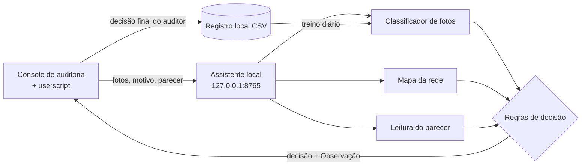

# auto-auditoria


Ferramenta local de apoio à auditoria de ordens de serviço (OS) não concluídas nos motivos "Inexistência de Rede" e "Necessita Escavação". Ela cruza as fotos da OS, o mapa da rede e o parecer da equipe e sugere uma decisão com o texto da Observação já redigido. A decisão final continua sendo do auditor.

Roda inteira na máquina do auditor. O assistente escuta só em `127.0.0.1`.

## Contexto

Para auditar uma OS desse tipo, o auditor precisa conferir três fontes ao mesmo tempo:

- as fotos mostram mesmo uma escavação?
- o mapa confirma que não há rede ou matrícula ativa por perto?
- o parecer cita recusa do cliente, georadar, esgoto, pavimento duro ou outro motivo?

O projeto faz essa análise prévia e devolve o resultado no card do console de auditoria. As decisões finais dos auditores são registradas e alimentam o treino diário do classificador de fotos.

| Decisão | Significado |
|---|---|
| `ok` | As evidências sustentam o motivo registrado. |
| `conferir` | Há sinal ambíguo (fotos inconclusivas, GPS ausente, georadar, autorização da programação etc.). Precisa de olhar humano. |
| `erro` | Postergação indevida: recusa do cliente, ausência de evidência ou alegação que as fotos não confirmam. |

## Arquitetura



| Arquivo | Função |
|---|---|
| `auditoria_os.user.js` | Userscript do Tampermonkey. Envia fotos, motivo e parecer ao assistente e mostra a sugestão no card. |
| `assistente_auditoria.py` | Servidor HTTP local. Carrega o mapa, aplica as regras e devolve a decisão. Também executa o treino diário (`treino-diario`). |
| `classificador_escavacao.py` | Classificador de fotos: treino, teste por OS, revisão manual e garimpo de confusores. Tem menu interativo. |
| `iniciar_assistente.bat` | Sobe o assistente. |
| `treino_diario.bat` | Roda o treino diário. Com o argumento `agendado`, grava a saída em `assistente\treino_diario.log` e não pausa, para uso no Agendador de Tarefas. |

## Como a decisão é tomada

Só entram no escopo as OS cujo motivo contém "inexistência" (`INEX`) ou "necessita escavação" (`ESC`). As demais voltam com `escopo: false`.

**Fotos.** Cada foto recebe uma probabilidade de conter escavação, e a OS usa a maior delas:

- `>= 0.75` (`LIMIAR_OS_SIM`): fotos mostram escavação
- `<= 0.35`: fotos sem escavação
- entre os dois: inconclusivo

**Parecer.** O texto é normalizado (sem acento, minúsculas) e testado contra expressões regulares que detectam recusa do cliente, outro motivo de postergação, alegação de escavação, georadar, autorização da programação, esgoto, pavimento duro, tubulação estourada e escavação a 1,20 m ou mais.

**Mapa (apenas `INEX`).** A distância até a rede e a contagem de matrículas ativas vizinhas vêm do ponto das fotos, quando elas têm GPS no EXIF e o resultado é confiável, ou do ponto cadastrado da OS. As fotos só são usadas se a dispersão entre elas for de até 150 m e a distância calculada bater (diferença de até 3 m) com a do mapa. Se as fotos estiverem a mais de 100 m do ponto da OS, ou se a coordenada do mapa for imprecisa, a decisão vira `conferir`.

**Ordem das regras, resumida:**

1. Parecer indica recusa do cliente: `erro` (motivo provável "Cliente não permitiu").
2. Parecer sugere outro motivo: `conferir`.
3. `INEX`: sem rede a até `rede_max_m` e sem matrícula a até `matricula_max_m`, ou com fotos que mostram escavação, é `ok`. Havendo rede ou matrícula próxima, o resultado depende das fotos e do parecer: georadar ou autorização da programação levam a `conferir`, fotos inconclusivas também, e ausência de evidência leva a `erro`.
4. `ESC`: fotos com escavação dão `ok` (apoio da retro). Fotos inconclusivas, ou parecer citando solo duro ou esgoto sem foto, dão `conferir`. Sem fotos nem justificativa, `erro`.

O texto da Observação é montado a partir desses sinais e cita as distâncias e a contagem de matrículas usadas.

## Classificador de fotos

- Imagem redimensionada para 256 px de lado.
- Características extraídas com OpenCV: cor e textura (LBP `riu2`), mais histogramas dos canais a/b do LAB e do HSV (`feat_v2`).
- Modelo: `StandardScaler` + `RandomForestClassifier` (300 árvores, `min_samples_leaf=2`), salvo com joblib.
- Fotos revisadas manualmente entram no treino com peso 3 (`PESO_REVISADA`).

## Treino diário

`python assistente_auditoria.py treino-diario` lê as decisões finais dos auditores (`assistente/decisoes_finais.csv`) e as análises feitas (`registro_analises.csv`), separa as fotos em `com_escavacao` e `sem_escavacao`, manda os casos duvidosos para revisão e gera uma nova versão do modelo (`treino_validado`). O que já foi processado fica em `assistente/treino_processados.json`, então rodar duas vezes seguidas não reprocessa nada.

## Instalação

Requisitos:

- Python 3.10 ou superior
- Tampermonkey no navegador
- HTML do mapa exportado (`Mapa*.html`) na pasta do assistente ou na pasta acima. O assistente lê os dados embutidos no bloco `__blobs` (JSON em gzip/base64) e monta um KD-tree da rede e dos clientes.

```bash
pip install opencv-python numpy scikit-learn scipy joblib pillow
```

## Uso

1. Treinar o classificador: `python classificador_escavacao.py`, opção 1, com as pastas `com_escavacao` e `sem_escavacao`.
2. Colocar o HTML do mapa na pasta e executar `iniciar_assistente.bat`.
3. Instalar `auditoria_os.user.js` no Tampermonkey e abrir o console de auditoria.
4. No fim do dia, executar `treino_diario.bat`.

Para testar uma OS sem passar pelo navegador, o assistente tem um modo de teste por linha de comando (`testar_os` em `assistente_auditoria.py`).

## Configuração

Na primeira execução o assistente cria `assistente_config.json` com os valores abaixo. Qualquer chave pode ser alterada.

| Chave | Padrão | Descrição |
|---|---|---|
| `porta` | `8765` | Porta do servidor local |
| `mapa` | (detectado) | Caminho do HTML do mapa. Se vazio, usa o `Mapa*.html` mais recente |
| `modelo` | `modelo_escavacao.joblib` | Arquivo do modelo |
| `rede_max_m` | `20` | Distância máxima à rede para considerar "rede próxima" |
| `matricula_max_m` | `8` | Distância máxima para considerar matrícula ativa vizinha |
| `matricula_ignorar_m` | `1` | Matrículas mais próximas que isso são desconsideradas |
| `salvar_fotos` | `true` | Guarda as fotos analisadas para o treino diário |

## Limitações

- As regras de decisão são fixas no código e dependem de expressões regulares sobre o parecer. Pareceres com redação muito diferente do esperado podem passar sem sinal.
- O classificador usa características clássicas de imagem, não uma rede neural. Fotos com iluminação ou enquadramento atípicos tendem a cair na faixa inconclusiva.
- Fotos sem GPS obrigam o uso do ponto cadastrado da OS, que pode ser impreciso.
- Os atalhos de execução são `.bat`, ou seja, Windows. No Linux e no macOS os comandos são os mesmos, mas é preciso rodar os `.py` direto.

## Dados e privacidade

Nenhum dado operacional faz parte do repositório: fotos, mapa, planilhas, modelos treinados, logs e registros ficam fora, e o `.gitignore` cobre esses arquivos.
