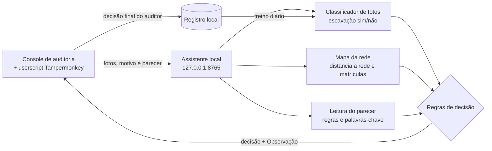

# Análise prévia de auditoria de serviços não concluídos

> Assistente local que apoia o auditor na revisão de ordens de serviço (OS) não concluídas nos motivos **"Inexistência de Rede"** e **"Necessita Escavação"**: cruza fotos, mapa da rede e parecer da equipe e sugere a decisão com o texto da Observação.


---

## O problema

Auditar OS não concluídas é repetitivo e exige conferir várias fontes ao mesmo tempo:

- as **fotos** da equipe mostram mesmo uma escavação?
- o **mapa** confirma que não há rede próxima ou matrícula ativa por perto?
- o **parecer** cita recusa do cliente, georadar, esgoto, pavimento duro ou outro motivo?

Feito manualmente, o processo é lento e sujeito a variação entre auditores.

## A solução

O projeto automatiza a análise prévia e entrega, direto no card do console de auditoria, uma **sugestão de decisão** com a **Observação** já redigida. O auditor continua com a palavra final, e as decisões dele alimentam o treino diário do modelo.

| Decisão sugerida | Significado |
|---|---|
| ✅ **ok** | As evidências sustentam o motivo registrado. |
| ⚠️ **conferir** | Há sinal ambíguo (fotos inconclusivas, GPS ausente, georadar, autorização da programação etc.). Exige olhar humano. |
| ❌ **erro** | Postergação indevida: recusa do cliente, ausência de evidência ou alegação que as fotos não confirmam. |

## Como funciona



1. **Userscript** (`auditoria_os.user.js`) envia fotos, motivo e parecer ao assistente e exibe a sugestão no card.
2. **Classificador de fotos** estima a probabilidade de a foto mostrar escavação. Acima de 0,75 conta como "sim", e abaixo de 0,35 como "não". Entre os dois, "incerto".
3. **Mapa** informa a distância até a rede de água e as matrículas ativas vizinhas. Quando as fotos têm GPS, o local das fotos é usado no lugar do ponto cadastrado da OS.
4. **Parecer** é lido em busca de sinais como recusa, outro motivo, georadar, esgoto, tubulação estourada e escavação profunda.
5. **Regras de decisão** combinam tudo e geram `ok`, `conferir` ou `erro` com a Observação pronta.
6. O **treino diário** incorpora as decisões finais dos auditores e só adota o novo modelo se a validação não piorar.

## Componentes

| Arquivo | Função |
|---|---|
| `auditoria_os.user.js` | Script do Tampermonkey para o console de auditoria. Envia fotos, motivo e parecer ao assistente local e mostra a sugestão no card. |
| `assistente_auditoria.py` | Assistente local (servidor HTTP em `127.0.0.1`). Junta mapa, fotos e parecer e devolve a decisão e o texto da Observação. Inclui a rotina de treino diário. |
| `classificador_escavacao.py` | Classificador de fotos (escavação sim/não): treino, teste por OS, revisão manual e garimpo de confusores. |
| `iniciar_assistente.bat` | Inicia o assistente. |
| `treino_diario.bat` | Executa a rotina de treino diário (manual ou agendada com o argumento `agendado`). |

## Tecnologias

- **Python 3.10+** com servidor HTTP da biblioteca padrão
- **OpenCV** e **NumPy** para extração de características das imagens (cor, textura LBP, histogramas em LAB/HSV)
- **scikit-learn**: pipeline `StandardScaler` + `RandomForestClassifier` (300 árvores)
- **SciPy** (`cKDTree`) para consultas espaciais rápidas à rede e às matrículas
- **Tampermonkey** (userscript) para integrar ao console web

## Instalação

```bash
pip install opencv-python numpy scikit-learn scipy joblib pillow
```

Instale também a extensão **Tampermonkey** no navegador.

## Uso

1. **Treinar o classificador**: `python classificador_escavacao.py` (opção 1), com as pastas `com_escavacao` e `sem_escavacao`.
2. **Iniciar o assistente**: coloque o HTML do mapa na pasta do assistente e execute `iniciar_assistente.bat`.
3. **Instalar o userscript**: adicione `auditoria_os.user.js` ao Tampermonkey e abra o console de auditoria.
4. **Treino diário**: ao fim do dia, execute `treino_diario.bat`.

### Parâmetros ajustáveis

O assistente cria o `assistente_config.json` na primeira execução:

| Chave | Padrão | Descrição |
|---|---|---|
| `porta` | `8765` | Porta do servidor local |
| `rede_max_m` | `20` | Distância máxima (m) até a rede para considerar "rede próxima" |
| `matricula_max_m` | `8` | Distância máxima (m) para considerar matrícula ativa vizinha |
| `salvar_fotos` | `true` | Guarda as fotos analisadas para o treino diário |

## Privacidade e segurança

- Tudo roda **na máquina do auditor**: o assistente escuta apenas em `127.0.0.1`.
- Nenhum dado operacional (fotos, mapa, planilhas, modelos treinados) faz parte deste repositório. O `.gitignore` bloqueia esses arquivos.
- A decisão final é sempre do auditor. A ferramenta apenas sugere.

## Roadmap

- [ ] Instruções de instalação para Linux e macOS (hoje os atalhos são `.bat`)
- [ ] Testes automatizados para as regras de decisão
- [ ] Relatório de acurácia do classificador por versão do modelo
- [ ] Separar `assistente_auditoria.py` em módulos (mapa, regras, treino, servidor)

## Licença

Defina a licença do projeto (por exemplo, MIT) e adicione o arquivo `LICENSE`.
